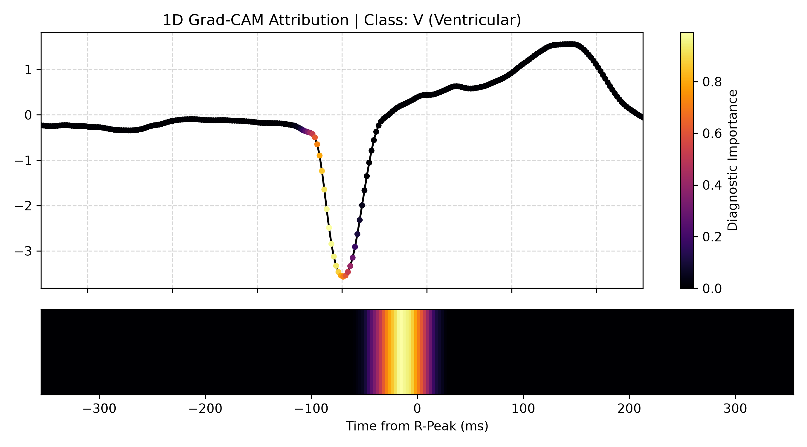

# ECG Arrhythmia Classification with Explainable AI (XAI)

An end-to-end deep learning pipeline for automated cardiac arrhythmia detection using the MIT-BIH Arrhythmia Database. Evaluated under the strict **AAMI EC57 standard** with an inter-patient train/test split to prevent patient data leakage.

---

## Model Architecture & Pipeline
- **Preprocessing:** 0.5–45 Hz Bandpass Butterworth filtering + R-peak beat segmentation (256 samples @ 360 Hz ≈ 711 ms).
- **Architecture:** 3-stage 1D-CNN (morphological feature extractor) + Bidirectional LSTM (temporal rhythm modeling) + Global Max Pooling.
- **Optimization:** Multiclass Focal Loss ($\gamma = 2.0$) with dynamic inverse class-frequency weighting.
- **Explainability:** 1D Grad-CAM diagnostic attribution heatmaps mapping attention back to the ECG waveform.

---

## Inter-Patient Benchmark Results (AAMI EC57 / DS2 Cohort)

Evaluated on **49,693 unseen heartbeats** from 22 test patients (Chazal et al. partition):

| Cardiac Class | Precision | Recall (Sensitivity) | F1-Score | Support |
|---|---|---|---|---|
| **N (Normal)** | 0.9526 | 0.8375 | 0.8913 | 44,241 |
| **S (Supraventricular)** | 0.0614 | 0.2052 | 0.0945 | 1,837 |
| **V (Ventricular Ectopic)** | **0.8333** | **0.8149** | **0.8240** | 3,220 |
| **F (Fusion)** | 0.0372 | 0.1443 | 0.0592 | 388 |
| **Q (Unknown / Paced)** | 0.0000 | 0.0000 | 0.0000 | 7 |
| **Macro Average** | **0.3769** | **0.4004** | **0.3738** | 49,693 |

---

## Explainability (1D Grad-CAM)

The model highlights morphological anomalies (such as premature ventricular depolarization and widened QRS complexes) using class attribution gradients:



---

## How to Run

```bash
# 1. Download records from PhysioNet
python download_data.py

# 2. Filter, segment, and cache arrays
python preprocess.py

# 3. Train network using Focal Loss
python train.py

# 4. Evaluate on unseen patients
python evaluate.py

# 5. Generate Grad-CAM attribution plot
python explain.py